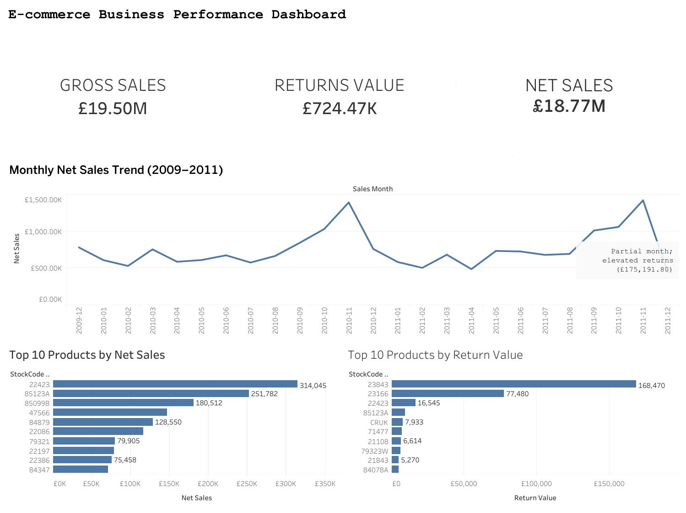

# **E-commerce Business Performance Analysis**

### End-to-End Data Analytics Portfolio Project | Python · SQL · Tableau

## Project Overview

This independent data analytics project investigates the sales performance, product profitability indicators, customer purchasing behaviour, and revenue trends of a UK-based online retailer using the UCI Online Retail II dataset.

The analysis transforms over 1 million transaction records into business insights through data cleaning, exploratory data analysis, SQL queries, customer segmentation, product performance analysis, and interactive dashboard development.

The objective is to identify revenue drivers, understand customer behaviour, investigate returns, and support data-driven business decisions.

## Business Objectives

- Evaluate overall sales performance and revenue trends.
- Identify high-performing, growing, and declining products.
- Investigate product returns and their financial impact.
- Analyse customer purchasing behaviour and revenue concentration.
- Segment customers using Recency, Frequency, and Monetary (RFM) analysis.
- Evaluate customer retention and seasonal purchasing patterns.
- Develop a Tableau dashboard to communicate business performance.

## Dataset

**Source:** [UCI Online Retail II](https://archive.ics.uci.edu/dataset/502/online+retail+ii)

**Period:** December 2009 – December 2011

**Original records:** 1,067,371

The dataset contains transactional information including invoice numbers, product codes, descriptions, quantities, invoice dates, unit prices, customer identifiers, and countries.

## Data Preparation

The project includes data quality investigation and a reproducible Python cleaning pipeline.

Key preparation activities included:

- Identifying and removing 34,335 exact duplicate records.
- Investigating missing customer identifiers and product descriptions.
- Separating merchandise transactions from delivery charges and operational adjustments.
- Identifying cancellations and returned products.
- Excluding zero-price inventory adjustments from merchandise revenue.
- Preparing cleaned datasets for business analysis and visualization.

Customer records without identifiers were retained for overall sales analysis but excluded from customer-level segmentation.

## Key Business Findings

### Sales Performance

| Metric                  |    Result |
| ----------------------- | --------: |
| Gross Merchandise Sales |  £19.50M |
| Returns Value           | £724.47K |
| Net Merchandise Sales   |  £18.77M |
| Sales Value Return Rate |     3.72% |
| Unit Return Rate        |     4.09% |

Net merchandise sales were calculated after deducting product cancellation and return values.

November 2011 generated the highest monthly net merchandise sales, approximately £1.42 million.

December 2011 is a partial month and includes unusually high return values, requiring careful interpretation when comparing monthly performance.

### Product Performance

The product analysis examines revenue contribution, product returns, growth trends, revenue stability, and seasonal demand.

The analysis identifies products that contribute strongly to revenue, products with declining performance, and products requiring closer monitoring because of return exposure or inconsistent demand.

### Customer Behaviour

Customer-level analysis investigates purchasing frequency, spending patterns, repeat purchasing, and revenue concentration.

RFM segmentation was used to group customers according to recency, frequency, and monetary value.

Cohort analysis was also performed to evaluate customer retention across different acquisition periods.

## Interactive Tableau Dashboard

Live Interactive Dashboard

[View Interactive Dashboard on Tableau Public](https://public.tableau.com/views/ecommerce_business_performance/Dashboard1)

Dashboard Preview



The Tableau dashboard provides a consolidated view of business performance, including:

- Gross sales, returns value, and net sales KPIs.
- Monthly net sales trends.
- Top 10 products by net sales.
- Top 10 products by return value.

**[View the Tableau packaged workbook](dashboard/ecommerce_business_performance.twbx)**

## How to Run the Project

### 1. Clone the Repository

git clone https://github.com/ambili-01/ecommerce-business-performance-analysis.git

cd ecommerce-business-performance-analysis

### 2. Install Dependencies

```bash
pip install -r requirements.txt
```

### 3. Download the Dataset

Download the UCI Online Retail II dataset.

Extract the Excel file and place it at:

data/online_retail_II.xlsx

### 4. Run the Data Cleaning Pipeline

```bash
python run_pipeline.py
```

The cleaned dataset will be saved to:

`data/processed/online_retail_cleaned.parquet`

### 5. Explore the Analysis

Open the Jupyter notebook:

```bash
jupyter lab notebooks/01_data_exploration.ipynb
```

### 6. Run Automated Tests

```bash
python -m pytest tests/
```

## Technologies Used

**Python:** Pandas, NumPy, Matplotlib, data cleaning, exploratory analysis, and KPI calculations.

**SQL:** Sales KPIs, monthly sales trends, product performance, and customer analysis.

**Tableau:** Interactive business performance dashboard.

**Jupyter Notebook:** Data exploration, statistical summaries, and visualizations.

**Testing:** Python automated tests for data cleaning.

**Git and GitHub:** Version control and project documentation.

## Project Structure

```text
ecommerce-business-performance-analysis/
├── dashboard/
│   └── ecommerce_business_performance.twbx
├── data/
│   └── processed/
├── images/
├── notebooks/
│   └── 01_data_exploration.ipynb
├── reports/
│   ├── customer_behaviour_analysis.md
│   ├── data_quality_investigation.md
│   └── product_performance_analysis.md
├── sql/
│   ├── 01_sales_kpis.sql
│   ├── 02_monthly_sales.sql
│   ├── 03_top_products.sql
│   └── 04_top_customers.sql
├── src/
│   └── data_cleaning.py
├── tests/
│   └── test_data_cleaning.py
├── run_pipeline.py
└── README.md
```

## Detailed Analysis

- [Data Quality Investigation](reports/data_quality_investigation.md)
- [Product Performance Analysis](reports/product_performance_analysis.md)
- [Customer Behaviour Analysis](reports/customer_behaviour_analysis.md)
- [SQL Business Queries](sql/)
- [Python Analysis Notebook](notebooks/01_data_exploration.ipynb)

## Monte Carlo Simulation & Revenue Risk Analysis

Extended the business performance analysis with
historical bootstrap Monte Carlo simulation to
evaluate monthly revenue uncertainty and assess
business target achievement probabilities.

### Methodology

- Historical bootstrap sampling
- 23 complete months of historical data
- 10,000 simulated revenue scenarios
- Statistical distribution analysis
- Revenue shortfall probability assessment
- Scenario and sensitivity analysis
- Historical distribution validation

### Key Results

| Metric                                   |    Result |
| ---------------------------------------- | --------: |
| Simulated scenarios                      |    10,000 |
| Expected monthly net revenue             | £765,371 |
| Median monthly net revenue               | £679,338 |
| £500K target achievement probability    |    91.69% |
| £700K target achievement probability    |    43.10% |
| £700K revenue shortfall risk            |    56.90% |
| Historical vs. simulated mean difference |     0.27% |

The simulation supports revenue planning and risk
assessment based on historical performance.
Seasonality and external market factors are not
explicitly modeled.

**Notebook:** [Revenue Risk Simulation](notebooks/revenue_risk_simulation.ipynb)

**Technologies:** Python, Pandas, NumPy, SciPy,
Matplotlib, Seaborn.

## Business Value

This project demonstrates how transactional data can be transformed into meaningful business information.

The analysis supports identifying revenue-generating products, understanding the impact of returns, evaluating customer purchasing patterns, and identifying opportunities for customer retention and product performance improvement.

## Dataset Attribution

Chen, D. (2012). *Online Retail II*. UCI Machine Learning Repository.

DOI: https://doi.org/10.24432/C5CG6D

Dataset license: CC BY 4.0.
