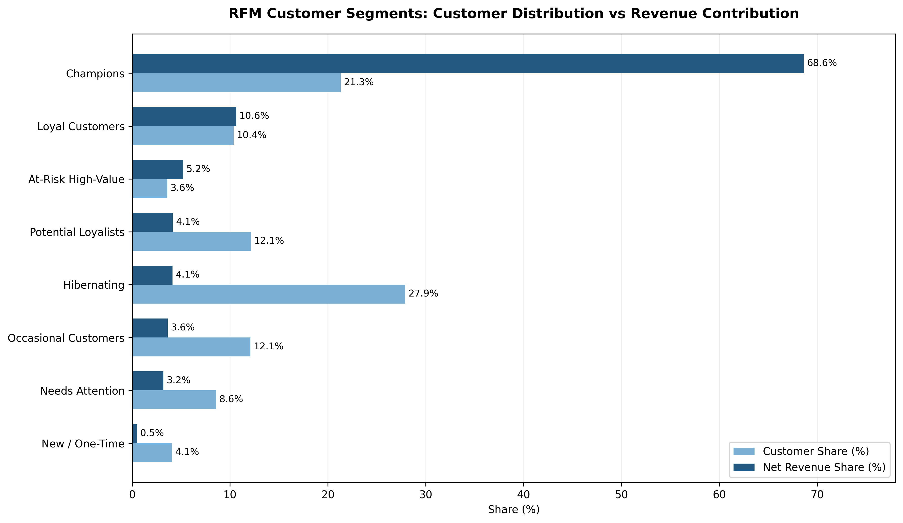
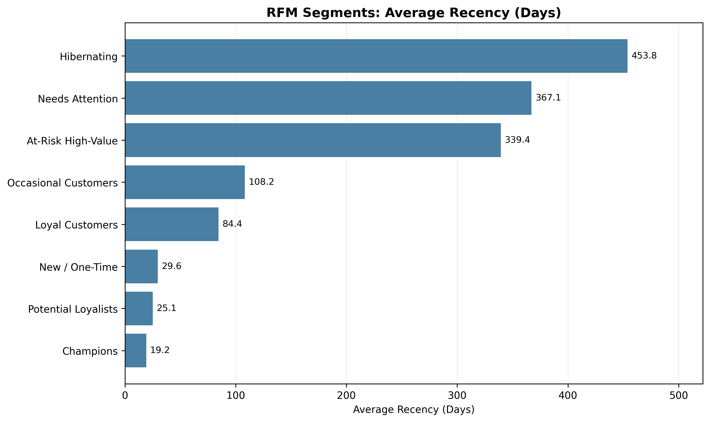
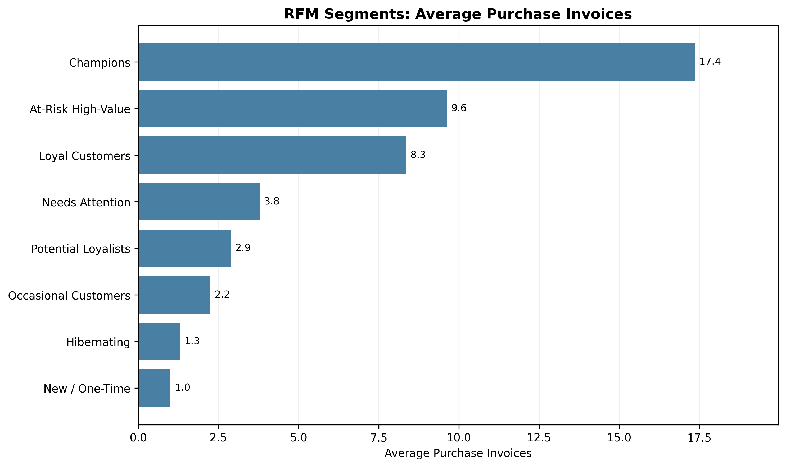
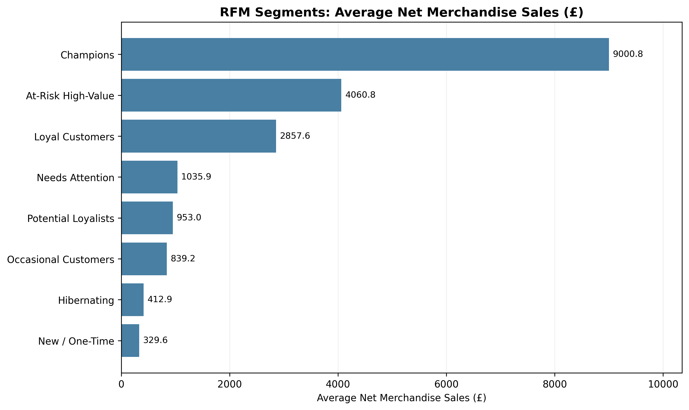
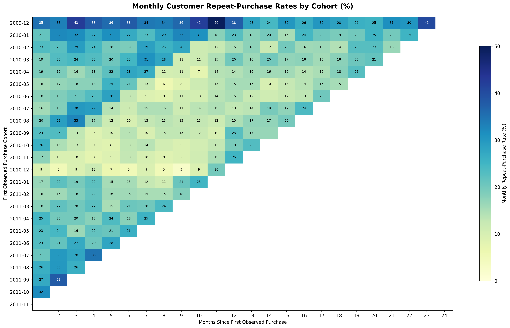

# Customer Behaviour Analysis

## 1. Executive Summary

This analysis examines customer purchasing behaviour, revenue
concentration, product returns, RFM segmentation and cohort
retention using historical e-commerce transaction data.

The dataset contains 5,878 uniquely identified customers,
including 5,855 customers with recorded purchases.

Among purchasing customers, 4,234 (72.31%) made repeat purchases,
accounting for 96.74% of identified gross merchandise sales.
This demonstrates the substantial revenue contribution of
repeat purchasing.

Customer revenue was highly concentrated. The top 10% of
purchasing customers generated 63.90% of identified gross sales.

RFM segmentation identified eight customer groups. The
Champions segment contained 1,247 customers and generated
approximately £11.22 million in net sales.

Cohort analysis showed a weighted month-1 retention rate
of 23.35%, indicating opportunities to investigate
repeat-purchase behaviour after customers' initial
purchase month.

The findings provide a foundation for understanding
customer value, monitoring high-value customers,
investigating return behaviour and evaluating
customer retention strategies.

### Data Coverage and Limitations

The analysis includes 1,023,906 merchandise transaction
records, of which 794,199 contain customer identifiers
and 229,707 do not.

Customer-level results therefore represent identifiable
customers rather than the complete customer population.

Revenue concentration and repeat-purchase statistics use
gross sales, while RFM monetary analysis uses net sales.

The dataset is historical and does not contain customer
acquisition costs, marketing campaign attribution or
confirmed reasons for customer inactivity.

## 2. Customer Purchasing Behaviour

### 2.1 Customer Identification Coverage

The analysis examined 1,023,906 merchandise transaction
records, including 794,199 records with customer identifiers
and 229,707 records without customer identifiers.

A total of 5,878 unique customers were identified,
of whom 5,855 had recorded purchases.

| Metric | Value |
|---|---:|
| Total Product Records | 1,023,906 |
| Records With Customer ID | 794,199 |
| Records Without Customer ID | 229,707 |
| Unique Identified Customers | 5,878 |
| Sales Records With Customer ID | 776,593 |
| Return Records With Customer ID | 17,606 |

### 2.2 One-Time vs Repeat Customers

Customers were classified according to their number of
distinct purchase invoices.

One-time customers completed one purchase, while repeat
customers completed more than one purchase.

| Customer Type | Customers | Gross Sales (£) | Average Purchases | Customer Share | Revenue Share |
|---|---:|---:|---:|---:|---:|
| One-Time Customer | 1,621 | 555,969.97 | 1.00 | 27.69% | 3.26% |
| Repeat Customer | 4,234 | 16,512,369.81 | 8.26 | 72.31% | 96.74% |

### 2.3 Repeat Purchasing Patterns

The analysis identified 4,234 repeat customers,
representing 72.31% of purchasing customers.

These customers generated approximately £16.51 million
in gross sales, accounting for 96.74% of identified
gross merchandise revenue.

Repeat customers completed an average of 8.26
distinct purchase invoices.

In comparison, 1,621 one-time customers represented
27.69% of purchasing customers but contributed only
3.26% of identified gross sales.

### 2.4 Business Interpretation

Repeat purchasing was a major contributor to
identified customer revenue during the analyzed period.

The large revenue difference between repeat and
one-time customers suggests that understanding
repeat-purchase behaviour is important for
customer relationship management.

Potential business opportunities include:

- Monitoring purchasing frequency among existing customers.
- Investigating barriers to second purchases.
- Evaluating customer retention initiatives.
- Identifying changes in repeat-customer purchasing patterns.

These results describe historical purchasing behaviour.
They do not establish whether retention initiatives
would cause additional purchases.

## 3. Customer Revenue Concentration

### 3.1 Revenue Distribution Across Customers

Customer revenue concentration was analyzed by ranking
purchasing customers according to their total gross sales.

The analysis evaluated the revenue contribution of the
top 1%, 5%, 10% and 20% of customers.

| Top Customer Group | Customers | Gross Sales (£) | Revenue Share |
|---|---:|---:|---:|
| Top 1% | 59 | 5,476,988.79 | 32.09% |
| Top 5% | 293 | 8,872,790.91 | 51.98% |
| Top 10% | 586 | 10,905,820.25 | 63.90% |
| Top 20% | 1,171 | 13,172,001.53 | 77.17% |

### 3.2 High-Value Customer Contribution

Revenue was strongly concentrated among a relatively
small proportion of purchasing customers.

The top 1% of customers (59 customers) generated
approximately £5.48 million, representing 32.09%
of identified gross merchandise sales.

The top 5% (293 customers) contributed approximately
£8.87 million, accounting for 51.98% of gross sales.

The top 10% (586 customers) generated approximately
£10.91 million, representing 63.90% of gross sales.

The top 20% (1,171 customers) contributed approximately
£13.17 million, accounting for 77.17% of gross sales.

These groups are cumulative rather than independent.

### 3.3 Business Interpretation

The findings demonstrate substantial customer revenue
concentration during the analyzed period.

A relatively small group of high-spending customers
contributed a large proportion of identified revenue.

This concentration highlights the importance of
understanding the purchasing patterns of high-value
customers.

It also suggests potential revenue exposure if major
customers reduce their purchasing activity.

### 3.4 Business Opportunities

Potential actions include:

- Monitor purchasing trends among high-value customers.
- Identify changes in purchase frequency and order value.
- Investigate customer inactivity and declining spending.
- Evaluate retention opportunities for valuable customers.
- Track changes in customer revenue concentration over time.

Revenue concentration alone does not establish customer
profitability, customer lifetime value or future revenue risk.

The analysis uses identified gross merchandise sales
rather than net sales after returns.

## 4. Customer Return Behaviour

### 4.1 Customer Return Overview

Customer return behaviour was examined using identified
merchandise transactions, including cancellation and
return records.

The analysis identified 2,447 customers with recorded
returns, representing £717,930.96 in return value.

| Metric | Value |
|---|---:|
| Customers with Recorded Returns | 2,447 |
| Identified Return Records | 17,606 |
| Total Identified Return Value | £717,930.96 |
| Identified Gross Sales | £17,068,340 approximately |
| Identified Net Sales | £16,350,410 approximately |

### 4.2 Concentration of Customer Returns

Return values were highly concentrated among a small
number of customers.

The 15 customers with the highest return values
accounted for £396,441.84, representing 55.22%
of total identified merchandise returns.

| Customer ID | Return Records | Return Invoices | Return Value (£) |
|---|---:|---:|---:|
| 16446 | 2 | 2 | 168,478.60 |
| 12346 | 2 | 2 | 77,188.10 |
| 15749 | 5 | 1 | 22,998.40 |
| 12931 | 57 | 11 | 20,800.37 |
| 14911 | 343 | 93 | 13,730.36 |
| 14277 | 84 | 5 | 12,829.34 |
| 16029 | 22 | 6 | 12,554.16 |
| 12454 | 31 | 3 | 12,360.82 |
| 17450 | 12 | 4 | 11,140.34 |
| 16754 | 24 | 5 | 10,807.25 |
| 17949 | 18 | 12 | 9,364.42 |
| 14096 | 16 | 16 | 7,933.43 |
| 16684 | 30 | 9 | 5,612.48 |
| 14607 | 30 | 5 | 5,348.90 |
| 14156 | 72 | 38 | 5,294.87 |

### 4.3 Exceptional Customer Returns

Customer 16446 recorded £168,478.60 in returns
across two return records.

Customer 12346 recorded £77,188.10 in returns,
also across two return records.

These two customers contributed substantial return
values despite having relatively few return records.

In contrast, customer 14911 recorded 343 return
records across 93 return invoices, with a total
return value of £13,730.36.

This illustrates the distinction between return
frequency and financial return impact.

A customer with few return transactions can generate
a larger financial impact than a customer with many
smaller returns.

### 4.4 Business Interpretation

The results indicate that return values are unevenly
distributed across identified customers.

Exceptional cancellations can significantly affect
customer-level net revenue and return metrics.

Return frequency alone is therefore insufficient
for evaluating customer return behaviour.

Both return value and return frequency should be
considered when investigating unusual patterns.

### 4.5 Business Opportunities

Potential actions include:

- Monitor customers with unusually high return values.
- Investigate exceptional cancellation transactions.
- Distinguish frequent small returns from large cancellations.
- Compare customer gross sales, return values and net sales.
- Track customer return behaviour over time.
- Review unusual transactions before interpreting customer value.

High return values do not establish customer misconduct
or the reasons for cancellation.

The dataset does not contain confirmed return reasons,
so further operational information would be required
before drawing conclusions about individual customers.

## 5. RFM Customer Segmentation

### 5.1 RFM Analysis Methodology

Recency, Frequency and Monetary (RFM) analysis was used
to segment customers based on historical purchasing behaviour.

- Recency: Days since the customer's last recorded purchase.
- Frequency: Number of distinct purchase invoices.
- Monetary: Customer revenue after accounting for returns.

The analysis included 5,855 purchasing customers.

Customers were assigned RFM scores and classified into
eight behavioural segments.

### 5.2 Customer Segment Distribution

| Customer Segment | Customers | Net Sales (£) | Revenue Share | Avg. Recency (Days) | Avg. Frequency |
|---|---:|---:|---:|---:|---:|
| Champions | 1,247 | 11,223,942.57 | 68.64% | 19.2 | 17.35 |
| Loyal Customers | 607 | 1,734,580.32 | 10.61% | 84.4 | 8.34 |
| At-Risk High-Value | 209 | 848,710.61 | 5.19% | 339.4 | 9.62 |
| Potential Loyalists | 711 | 677,618.28 | 4.14% | 25.1 | 2.88 |
| Hibernating | 1,633 | 674,325.68 | 4.12% | 453.8 | 1.30 |
| Occasional Customers | 708 | 594,152.04 | 3.63% | 108.2 | 2.24 |
| Needs Attention | 502 | 520,041.62 | 3.18% | 367.1 | 3.78 |
| New / One-Time | 238 | 78,443.82 | 0.48% | 29.6 | 1.00 |

### 5.3 Champions

The Champions segment contained 1,247 customers and
generated approximately £11.22 million in net sales.

These customers had an average recency of 19.24 days
and an average purchase frequency of 17.35 invoices.

Champions represented the largest revenue-contributing
segment, accounting for approximately 68.64% of
purchasing-customer net sales.

Their purchasing behaviour indicates the importance
of maintaining relationships with recent, frequent
and high-value customers.

### 5.4 Loyal Customers

The Loyal Customers segment contained 607 customers
and generated approximately £1.73 million in net sales.

These customers completed an average of 8.34 purchases
and had an average recency of 84.40 days.

Their repeat purchasing suggests opportunities to
monitor engagement and maintain purchasing frequency.

### 5.5 At-Risk High-Value Customers

The At-Risk High-Value segment contained 209 customers
who generated approximately £848,711 in net sales.

Their average recency was 339.39 days, despite an
average purchase frequency of 9.62 invoices.

These customers had historically valuable purchasing
patterns but had not purchased recently relative to
the dataset's reference date.

This segment may warrant investigation for targeted
re-engagement opportunities.

### 5.6 Potential Loyalists

The Potential Loyalists segment contained 711 customers
and generated approximately £677,618 in net sales.

Their average recency was 25.07 days, with an average
purchase frequency of 2.88 invoices.

These customers purchased relatively recently but
had lower purchase frequency than Champions and
Loyal Customers.

They may represent an opportunity to investigate
how customers develop repeat-purchase habits.

### 5.7 Hibernating and Needs Attention Customers

The Hibernating segment contained 1,633 customers,
with an average recency of 453.76 days.

The Needs Attention segment contained 502 customers,
with an average recency of 367.10 days.

These segments highlight customers with longer periods
since their last recorded purchases.

Further analysis could examine historical purchasing
patterns and potential reasons for inactivity.

### 5.8 RFM Visualizations

### 5.9 Business Interpretation

RFM segmentation revealed substantial differences
in customer purchasing behaviour and revenue contribution.

Champions generated the majority of identified
purchasing-customer net sales, while At-Risk High-Value
customers represented historically valuable customers
with older purchase activity.

These findings support differentiated customer
monitoring and retention analysis.

However, RFM classifications describe historical
behaviour rather than predicting future purchases
or proving the effectiveness of retention campaigns.

## 6. Cohort Retention Analysis

### 6.1 Cohort Analysis Methodology

Customers were grouped into monthly cohorts based on
the month of their first recorded purchase.

Retention was measured by identifying customers who
made another purchase in subsequent calendar months.

Month 0 represents the customer's first purchase month.
Month 1 represents the following calendar month.

Weighted retention rates were calculated using the
number of returning customers divided by the total
customers in eligible cohorts.

Only cohorts with sufficient observation time were
included in each retention benchmark.

### 6.2 Customer Retention Benchmarks

| Month After First Purchase | Eligible Cohorts | Cohort Customers | Returning Customers | Weighted Retention |
|---|---:|---:|---:|---:|
| Month 1 | 23 | 5,635 | 1,316 | 23.35% |
| Month 3 | 21 | 5,226 | 1,305 | 24.97% |
| Month 6 | 18 | 4,910 | 1,089 | 22.18% |
| Month 12 | 12 | 4,241 | 964 | 22.73% |

### 6.3 Early Customer Retention

The weighted month-1 retention rate was 23.35%.

Across 23 eligible cohorts, 1,316 of 5,635
customers purchased again in the calendar month
following their first purchase.

This indicates that approximately 76.65% of
customers did not make another recorded purchase
during that specific following month.

However, these customers may have returned in
later months.

### 6.4 Medium-Term Customer Retention

Month-3 weighted retention was 24.97%,
based on 1,305 returning customers across
21 eligible cohorts.

Month-6 weighted retention was 22.18%,
based on 1,089 returning customers across
18 eligible cohorts.

These findings show that approximately
one-fifth to one-quarter of eligible customers
made purchases in the observed months.

### 6.5 Long-Term Customer Retention

Month-12 weighted retention was 22.73%.

Across 12 eligible cohorts, 964 of 4,241
customers made a recorded purchase during
the twelfth calendar month after their
first purchase.

This suggests that some customers continued
purchasing over longer periods.

However, month-12 retention does not mean
that these customers purchased in every
intervening month.

### 6.6 Cohort Retention Visualization

The heatmap illustrates monthly purchasing
retention across customer acquisition cohorts.

It helps identify differences in repeat-purchase
activity between cohorts and observation periods.

### 6.7 Business Interpretation

The analysis highlights opportunities to
investigate customer engagement after the
first purchase.

Potential areas for further investigation include:

- Understanding why customers do not purchase
  again in the following calendar month.
- Comparing retention patterns across cohorts.
- Monitoring changes in repeat-purchase behaviour.
- Evaluating initiatives designed to encourage
  subsequent purchases.

Retention percentages at different month indices
are based on different sets of eligible cohorts.

They should not be interpreted as a single
continuous customer survival curve.

The dataset does not establish the causes of
customer inactivity or the effectiveness
of specific retention strategies.

## 7. Key Business Insights

### 7.1 Repeat Customers Drive Most Identified Revenue

Repeat customers represented 72.31% of purchasing customers
but generated 96.74% of identified gross merchandise sales.

The 4,234 repeat customers completed an average of 8.26
distinct purchase invoices, compared with one invoice
for the 1,621 one-time customers.

This demonstrates the importance of repeat purchasing
to historical revenue performance.

### 7.2 Revenue Is Concentrated Among High-Spending Customers

The top 10% of purchasing customers generated 63.90%
of identified gross merchandise sales.

The top 1% alone contributed 32.09%.

This concentration highlights the importance of
monitoring high-value customer purchasing behaviour
and potential changes in their spending patterns.

### 7.3 Customer Returns Have Uneven Financial Impact

The analysis identified 2,447 customers with recorded
returns, representing £717,930.96 in return value.

The top 15 returning customers accounted for 55.22%
of this value.

Customer 16446 alone recorded £168,478.60 in returns
across two return records.

These findings demonstrate why return value and return
frequency should be evaluated separately.

### 7.4 Champions Are the Largest Revenue-Contributing RFM Segment

RFM segmentation identified 1,247 Champions generating
approximately £11.22 million in net sales.

This represented approximately 68.64% of purchasing-customer
net sales.

Their relatively recent and frequent purchasing activity
makes this segment important for customer monitoring
and retention analysis.

### 7.5 Historically Valuable Customers Show Inactivity

The At-Risk High-Value segment contained 209 customers
who generated approximately £848,711 in net sales.

Their average recency was 339.39 days despite an average
purchase frequency of 9.62 invoices.

This suggests an opportunity to investigate historically
valuable customers whose purchasing activity has declined.

### 7.6 Monthly Retention Highlights Repeat-Purchase Opportunities

Weighted month-1 cohort retention was 23.35%.

Month-3, month-6 and month-12 retention rates were
24.97%, 22.18% and 22.73%, respectively.

These results indicate that many customers did not
make purchases in the specific subsequent months examined.

The findings support further investigation into
repeat-purchase behaviour and customer engagement.

### 7.7 Customer Identification Limits Complete Analysis

Of 1,023,906 merchandise transaction records,
229,707 did not contain customer identifiers.

Consequently, customer-level findings describe
identified customers rather than the entire
customer population.

This limitation should be considered when interpreting
customer revenue contribution, returns and retention.

## 8. Business Recommendations

### 8.1 Strengthen Repeat-Purchase Engagement

Repeat customers generated 96.74% of identified gross
merchandise sales, while 1,621 purchasing customers
made only one recorded purchase.

**Recommended actions:**
- Monitor the proportion of one-time and repeat customers.
- Investigate barriers to second purchases.
- Evaluate follow-up communications after initial purchases.
- Track changes in purchasing frequency over time.

### 8.2 Monitor High-Value Customer Relationships

The top 10% of purchasing customers generated 63.90%
of identified gross sales.

This concentration makes changes in high-value customer
purchasing patterns particularly important to monitor.

**Recommended actions:**
- Track purchasing frequency and revenue among top customers.
- Identify significant reductions in historical spending.
- Review customer return values alongside gross sales.
- Investigate opportunities for appropriate customer engagement.

### 8.3 Investigate At-Risk High-Value Customers

RFM analysis identified 209 At-Risk High-Value customers,
representing approximately £848,711 in historical net sales.

Their average recency was 339.39 days.

**Recommended actions:**
- Review historical purchasing patterns within this segment.
- Identify customers with substantial previous spending
  but extended periods without recorded purchases.
- Evaluate targeted re-engagement initiatives.
- Measure subsequent purchasing activity to assess outcomes.

### 8.4 Maintain Engagement With Champions

The Champions segment contained 1,247 customers and
generated approximately £11.22 million in net sales.

These customers represented the largest revenue-contributing
RFM segment.

**Recommended actions:**
- Monitor changes in purchase frequency and recency.
- Investigate customer preferences and purchasing patterns.
- Evaluate loyalty and relationship-management initiatives.
- Track movement between RFM segments over time.

### 8.5 Improve Customer Return Monitoring

The top 15 returning customers accounted for 55.22%
of identified merchandise return value.

Exceptional cancellations contributed substantially
to the overall return value.

**Recommended actions:**
- Monitor both return frequency and financial return value.
- Flag unusually large cancellations for investigation.
- Compare customer gross sales, returns and net sales.
- Distinguish exceptional transactions from recurring
  smaller returns.
- Avoid assuming customer misconduct without supporting evidence.

### 8.6 Investigate Customer Retention Patterns

Weighted month-1 cohort retention was 23.35%,
indicating that many customers did not purchase again
in the calendar month following their first purchase.

**Recommended actions:**
- Monitor retention across monthly acquisition cohorts.
- Investigate differences in repeat-purchase behaviour.
- Evaluate initiatives encouraging subsequent purchases.
- Compare retention results using equivalent observation windows.
- Measure the effectiveness of any implemented initiatives.

### 8.7 Improve Customer Data Coverage and Reporting

Of 1,023,906 merchandise transaction records,
229,707 lacked customer identifiers.

Missing customer information limits the completeness
of customer-level analysis.

**Recommended actions:**
- Monitor the proportion of transactions with missing IDs.
- Investigate possible causes of missing identifiers.
- Maintain consistent customer identifier formats.
- Document customer-level data exclusions.
- Develop reproducible customer reporting workflows.

### 8.8 Establish a Customer Performance Dashboard

A consolidated dashboard could support regular
monitoring of customer behaviour.

**Suggested metrics:**
- Identified purchasing customers.
- One-time and repeat customer shares.
- Gross and net sales by customer group.
- Revenue concentration among top customers.
- Customer return frequency and value.
- RFM segment distribution and revenue contribution.
- Monthly cohort retention rates.

These recommendations are based on historical transaction
patterns. Their effectiveness would need to be evaluated
using additional operational information and subsequent
business results.

## 9. Conclusion

The Customer Behaviour Analysis examined historical
e-commerce purchasing patterns to understand customer
revenue contribution, repeat purchasing, return behaviour,
customer segmentation and monthly retention.

The analysis identified 5,878 customers, including
5,855 customers with recorded purchases.

Repeat customers represented 72.31% of purchasing
customers and contributed 96.74% of identified gross
merchandise sales. Revenue was also highly concentrated,
with the top 10% of purchasing customers generating
63.90% of identified gross sales.

Customer return analysis identified 2,447 customers
with recorded returns, representing £717,930.96
in return value. The top 15 returning customers
accounted for 55.22% of identified return value,
highlighting the financial impact of exceptional
cancellations and concentrated returns.

RFM analysis classified 5,855 purchasing customers
into eight behavioural segments. The Champions
segment contained 1,247 customers and generated
approximately £11.22 million in net sales.

The analysis also identified 209 At-Risk High-Value
customers whose historical purchasing activity
suggests opportunities for further investigation.

Cohort analysis revealed a weighted month-1 retention
rate of 23.35%, demonstrating the importance of
understanding purchasing behaviour after customers'
initial purchase month.

Overall, the findings provide a data-driven foundation
for customer monitoring, retention analysis, customer
segmentation and return-risk investigation.

### Analysis Limitations

Customer-level analysis was limited to transactions
with identifiable customer information.

Of 1,023,906 merchandise transaction records,
229,707 lacked customer identifiers.

The dataset contains historical transactions and
does not include customer acquisition costs,
marketing attribution, profit margins or confirmed
reasons for customer inactivity and returns.

RFM classifications describe historical purchasing
behaviour rather than predicting future activity.

Cohort retention rates measure purchases in specific
subsequent months and should not be interpreted
as continuous customer retention.

The recommendations therefore represent opportunities
for further investigation rather than confirmed
business improvements.

