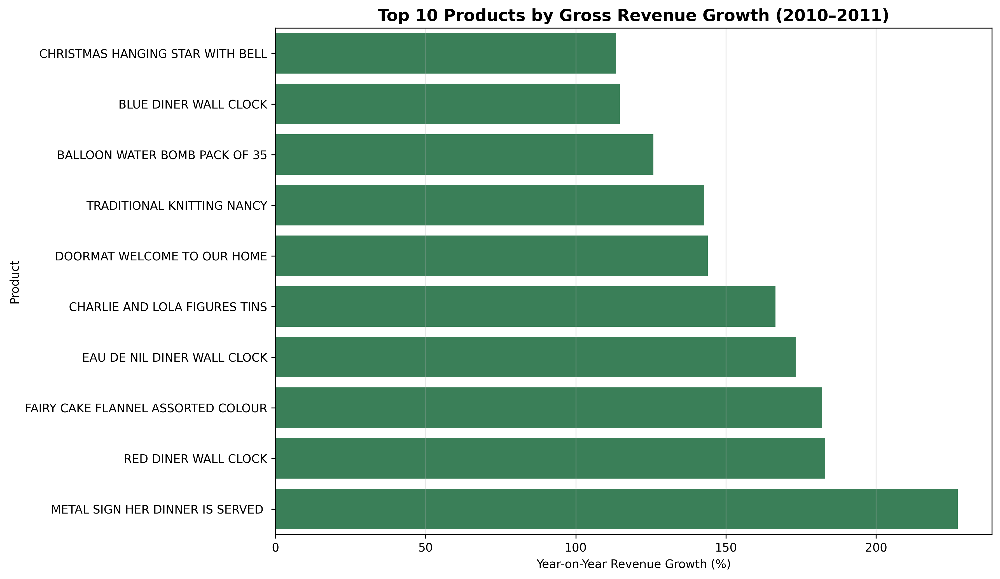
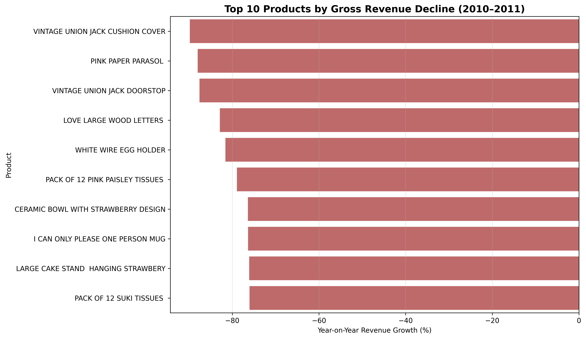
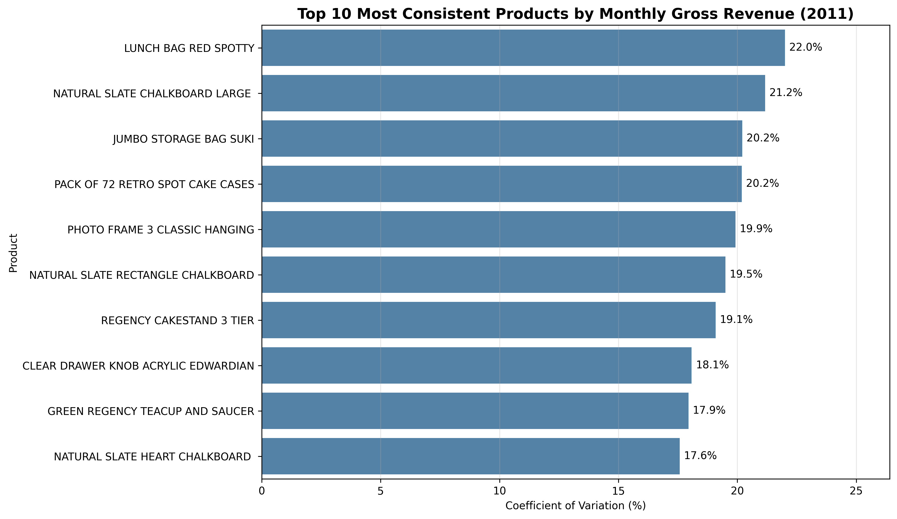
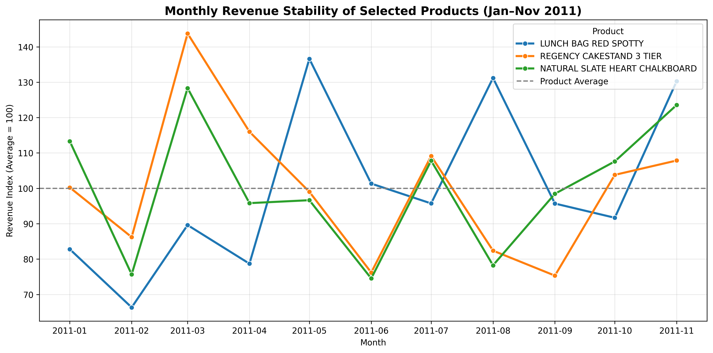
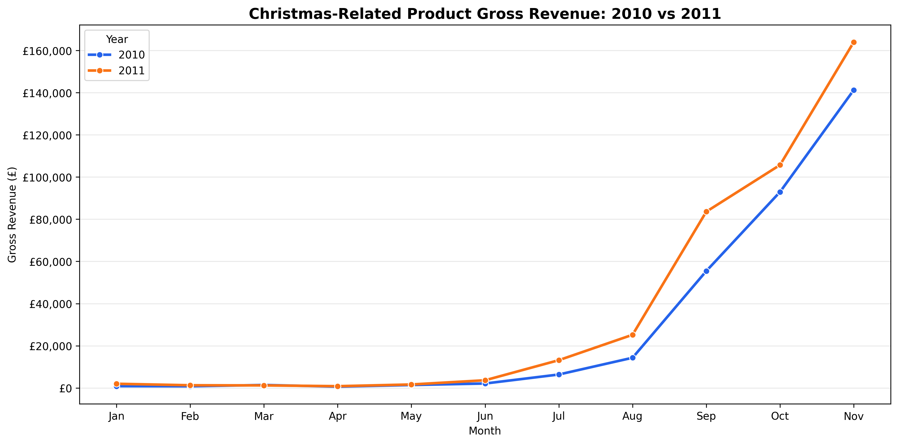
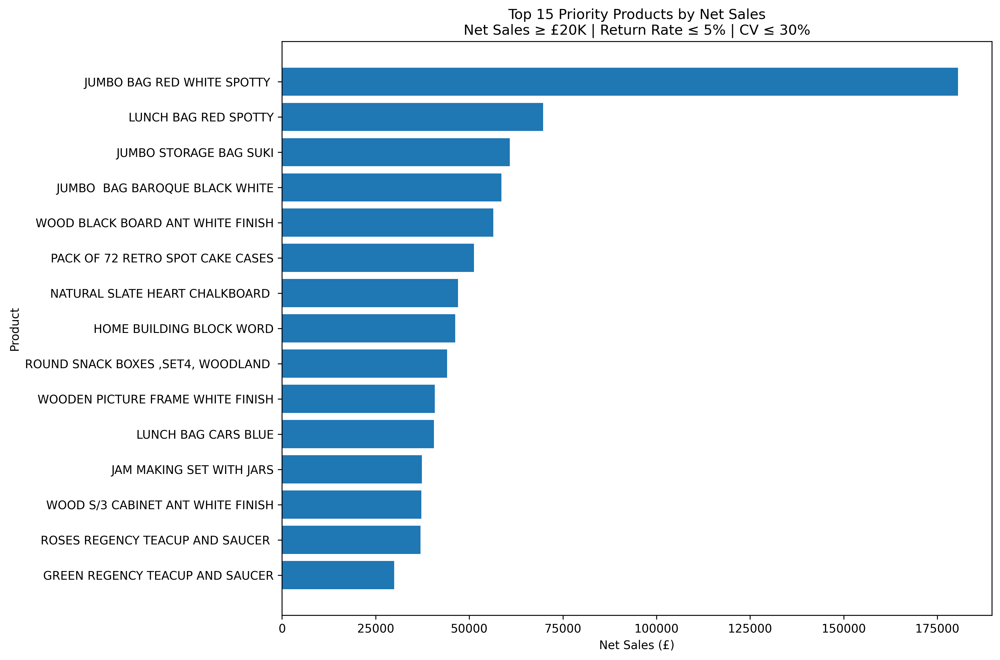
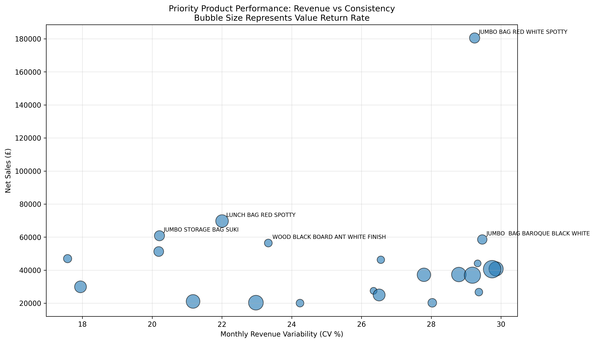

# Product Performance Analysis

## 1. Executive Summary

This analysis examines product-level sales performance in the Online Retail II dataset, covering transactions from December 2009 to December 2011. The objective is to identify revenue-generating products, investigate returns, assess demand patterns and highlight opportunities for better product and inventory decisions.

The analysis covers 1,023,906 merchandise transaction records after deduplication and transaction classification.

### Overall Merchandise Performance

| Metric | Value |
|---|---:|
| Gross merchandise sales | £19,497,760 |
| Product returns | £724,473 |
| Net merchandise sales | £18,773,290 |
| Sales value return rate | 3.72% |
| Unit return rate | 4.09% |

The results show that product cancellations and returns reduced gross merchandise sales by approximately 3.72%.

The analysis also examines product revenue growth and decline, seasonal demand, monthly revenue stability and return exposure to distinguish strong-performing products from those requiring further investigation.

These findings provide a foundation for product prioritization, inventory planning and return monitoring.

## 2. Product Sales Performance

### 2.1 Top Products by Net Sales

The analysis ranked merchandise products by net sales after deducting product return and cancellation values from gross sales.

| Rank | Product | Gross Sales (£) | Returns (£) | Net Sales (£) |
|---:|---|---:|---:|---:|
| 1 | REGENCY CAKESTAND 3 TIER | 330,590.32 | 16,545.30 | 314,045.02 |
| 2 | WHITE HANGING HEART T-LIGHT HOLDER | 260,990.22 | 9,387.10 | 251,603.12 |
| 3 | PARTY BUNTING | 148,318.28 | 1,238.55 | 147,079.73 |
| 4 | JUMBO BAG RED RETROSPOT | 148,073.47 | 2,127.42 | 145,946.05 |
| 5 | ASSORTED COLOUR BIRD ORNAMENT | 129,324.49 | 774.07 | 128,550.42 |
| 6 | PAPER CHAIN KIT 50'S CHRISTMAS | 117,760.29 | 1,461.70 | 116,298.59 |
| 7 | CHILLI LIGHTS | 80,540.88 | 635.75 | 79,905.13 |
| 8 | ROTATING SILVER ANGELS T-LIGHT HLDR | 71,300.40 | 330.45 | 70,969.95 |
| 9 | JUMBO BAG STRAWBERRY | 69,002.13 | 512.24 | 68,489.89 |
| 10 | RABBIT NIGHT LIGHT | 66,870.03 | 208.40 | 66,661.63 |

### 2.2 Gross Sales, Returns and Net Sales

REGENCY CAKESTAND 3 TIER generated the highest net sales at £314,045.02, followed by WHITE HANGING HEART T-LIGHT HOLDER at £251,603.12 and PARTY BUNTING at £147,079.73.

Although these products generated substantial revenue, their return values differed. REGENCY CAKESTAND 3 TIER recorded £16,545.30 in returns, while PARTY BUNTING recorded £1,238.55.

This demonstrates why product performance should be evaluated using net sales and return exposure rather than gross revenue alone.

### Business Interpretation

The highest-revenue products include decorative household items, seasonal products and reusable bags.

These products are important candidates for inventory planning and sales monitoring. However, product prioritization should also consider demand consistency, seasonality and return behaviour.

## 3. Product Revenue Trends

This section compares product revenue performance between January–November 2010 and January–November 2011, excluding incomplete December periods.

### 3.1 Growing Products

The following products recorded the highest percentage revenue growth among the products selected for the year-over-year comparison.

| Description | Revenue_2010 | Revenue_2011 | YoY_Growth_% | Unit_Growth_% |
| --- | --- | --- | --- | --- |
| METAL SIGN HER DINNER IS SERVED  | 1,166.59 | 3,816.95 | +227.19% | +266.50% |
| RED DINER WALL CLOCK | 3,860.36 | 10,929.78 | +183.13% | +177.30% |
| FAIRY CAKE FLANNEL ASSORTED COLOUR | 6,084.97 | 17,165.42 | +182.10% | +328.30% |
| EAU DE NIL DINER WALL CLOCK | 4,151.40 | 11,342.91 | +173.23% | +174.01% |
| CHARLIE AND LOLA FIGURES TINS | 1,313.27 | 3,499.53 | +166.47% | +314.52% |
| DOORMAT WELCOME TO OUR HOME | 4,426.89 | 10,799.55 | +143.95% | +132.22% |
| TRADITIONAL KNITTING NANCY | 3,730.67 | 9,054.81 | +142.71% | +101.34% |
| BALLOON WATER BOMB PACK OF 35 | 1,024.37 | 2,313.29 | +125.83% | +133.35% |
| BLUE DINER WALL CLOCK | 3,549.31 | 7,620.57 | +114.71% | +106.25% |
| CHRISTMAS HANGING STAR WITH BELL | 1,146.80 | 2,446.88 | +113.37% | +455.03% |

**Key findings:** METAL SIGN HER DINNER IS SERVED recorded the highest revenue growth at 227.19%, while FAIRY CAKE FLANNEL ASSORTED COLOUR achieved 182.10% revenue growth and 328.30% unit growth.

Revenue and unit growth together provide stronger evidence of increasing sales activity than revenue growth alone. However, percentage growth should be interpreted alongside absolute revenue and the starting sales base.

### 3.2 Declining Products

The following products experienced the largest percentage revenue declines within the selected comparison group.

| Description | Revenue_2010 | Revenue_2011 | YoY_Growth_% | Unit_Growth_% |
| --- | --- | --- | --- | --- |
| VINTAGE UNION JACK CUSHION COVER | 16,533.50 | 1,684.53 | -89.81% | -89.38% |
| PINK PAPER PARASOL  | 11,700.47 | 1,406.79 | -87.98% | -89.99% |
| VINTAGE UNION JACK DOORSTOP | 8,814.59 | 1,094.22 | -87.59% | -87.68% |
| LOVE LARGE WOOD LETTERS  | 5,855.78 | 1,002.93 | -82.87% | -84.22% |
| WHITE WIRE EGG HOLDER | 7,441.20 | 1,369.92 | -81.59% | -85.37% |
| PACK OF 12 PINK PAISLEY TISSUES  | 4,780.13 | 1,007.25 | -78.93% | -81.82% |
| CERAMIC BOWL WITH STRAWBERRY DESIGN | 4,736.53 | 1,118.20 | -76.39% | -78.25% |
| I CAN ONLY PLEASE ONE PERSON MUG | 5,247.91 | 1,241.15 | -76.35% | -78.12% |
| LARGE CAKE STAND  HANGING STRAWBERY | 13,931.96 | 3,330.26 | -76.10% | -77.41% |
| PACK OF 12 SUKI TISSUES  | 8,172.22 | 1,960.13 | -76.01% | -74.02% |

**Key findings:** VINTAGE UNION JACK CUSHION COVER experienced an 89.81% revenue decline, followed by PINK PAPER PARASOL at 87.98% and VINTAGE UNION JACK DOORSTOP at 87.59%.

The substantial decreases in units sold suggest weakening sales volumes. Possible explanations include changes in customer preferences, product availability or merchandising, but these causes cannot be established from transaction data alone.

### 3.3 Consistently Performing Products

Monthly revenue stability was evaluated using the coefficient of variation (CV), which measures monthly revenue variability relative to average monthly revenue. A lower CV indicates more consistent revenue within the analyzed period.

| Description | Total_Revenue | Average_Monthly_Revenue | Active_Months | CV_% |
| --- | --- | --- | --- | --- |
| NATURAL SLATE HEART CHALKBOARD  | 23,143.34 | 2,103.94 | 11 | 17.58% |
| GREEN REGENCY TEACUP AND SAUCER | 20,125.25 | 1,829.57 | 11 | 17.95% |
| CLEAR DRAWER KNOB ACRYLIC EDWARDIAN | 8,297.85 | 754.35 | 11 | 18.08% |
| REGENCY CAKESTAND 3 TIER | 140,467.66 | 12,769.79 | 11 | 19.09% |
| NATURAL SLATE RECTANGLE CHALKBOARD | 5,348.75 | 486.25 | 11 | 19.50% |
| PHOTO FRAME 3 CLASSIC HANGING | 5,276.01 | 479.64 | 11 | 19.92% |
| PACK OF 72 RETRO SPOT CAKE CASES | 18,058.00 | 1,641.64 | 11 | 20.19% |
| JUMBO STORAGE BAG SUKI | 28,336.14 | 2,576.01 | 11 | 20.21% |
| NATURAL SLATE CHALKBOARD LARGE  | 8,576.17 | 779.65 | 11 | 21.17% |
| LUNCH BAG RED SPOTTY | 33,640.27 | 3,058.21 | 11 | 22.00% |

**Key findings:** NATURAL SLATE HEART CHALKBOARD showed the lowest CV among the selected products at 17.58%. REGENCY CAKESTAND 3 TIER combined relatively stable monthly revenue with substantial total revenue of £140,467.66 across 11 analyzed months.

Products with relatively stable demand may be useful candidates for inventory planning, while rapidly growing and declining products require closer monitoring.

### Business Interpretation

The results reveal three distinct product performance patterns: growing products with increasing sales activity, declining products with reduced sales volumes, and relatively stable products with more predictable monthly revenue.

These distinctions can support product-level inventory reviews, targeted merchandising decisions and ongoing demand monitoring. Growth rates, revenue contribution and stability should be considered together rather than independently.

## 4. Seasonal Product Demand

### 4.1 Christmas Seasonality

The analysis examined 209 Christmas-related products to understand seasonal revenue patterns, product performance and purchasing activity.

Christmas-related merchandise demonstrated a strong seasonal increase in demand during the months preceding December.

#### Top 10 Christmas Products by Net Sales

| Product | Gross Sales (£) | Returns (£) | Net Sales (£) | Unit Return Rate |
|---|---:|---:|---:|---:|
| PAPER CHAIN KIT 50'S CHRISTMAS  | 117,760.29 | 1,461.70 | 116,298.59 | 1.68% |
| PAPER CHAIN KIT VINTAGE CHRISTMAS | 58,652.70 | 1,185.60 | 57,467.10 | 2.28% |
| SET OF 6 RIBBONS VINTAGE CHRISTMAS | 26,763.75 | 86.70 | 26,677.05 | 0.30% |
| JUMBO BAG 50'S CHRISTMAS  | 23,772.07 | 486.96 | 23,285.11 | 2.55% |
| CHRISTMAS LIGHTS 10 REINDEER | 21,727.58 | 610.30 | 21,117.28 | 2.83% |
| 15CM CHRISTMAS GLASS BALL 20 LIGHTS | 21,201.13 | 695.35 | 20,505.78 | 3.46% |
| 72 CAKE CASES VINTAGE CHRISTMAS | 19,240.05 | 241.20 | 18,998.85 | 1.62% |
| VINTAGE CHRISTMAS BUNTING | 15,798.66 | 64.35 | 15,734.31 | 0.43% |
| FELTCRAFT CHRISTMAS FAIRY | 15,282.81 | 120.75 | 15,162.06 | 1.12% |
| SET OF 20 VINTAGE CHRISTMAS NAPKINS | 15,275.82 | 334.22 | 14,941.60 | 2.59% |

PAPER CHAIN KIT 50'S CHRISTMAS generated the highest net sales at £116,298.59, followed by PAPER CHAIN KIT VINTAGE CHRISTMAS at £57,467.10.

These results indicate that Christmas-themed paper decorations and gift-related merchandise were important revenue contributors within the selected seasonal product group.

#### Monthly Christmas Product Revenue

| Month | Revenue (£) | Units Sold |
|---|---:|---:|
| January 2011 | 1,985.12 | 1,664 |
| February 2011 | 1,278.31 | 1,336 |
| March 2011 | 1,209.23 | 1,172 |
| April 2011 | 839.22 | 715 |
| May 2011 | 1,653.19 | 1,451 |
| June 2011 | 3,647.95 | 2,992 |
| July 2011 | 13,172.46 | 12,993 |
| August 2011 | 25,214.67 | 16,768 |
| September 2011 | 83,579.65 | 61,657 |
| October 2011 | 105,714.33 | 87,985 |
| November 2011 | 163,987.57 | 109,550 |
| December 2011 | 37,388.30 | 23,550 |

Christmas-product revenue increased from £83,579.65 in September 2011 to £105,714.33 in October and £163,987.57 in November.

November 2011 also exceeded November 2010 Christmas-product revenue by approximately 16.1%.

December 2011 contains only partial-month data and should not be directly compared with complete months.

### 4.2 Monthly Revenue Stability

Overall merchandise revenue also showed strong performance during the autumn months.

| Month | Net Merchandise Sales (£) |
|---|---:|
| November 2011 | 1,423,356.21 |
| November 2010 | 1,394,652.86 |
| October 2011 | 1,059,297.26 |
| October 2010 | 1,030,164.19 |
| September 2011 | 1,010,137.31 |

November 2011 recorded the highest overall monthly net merchandise sales at £1,423,356.21, followed by November 2010 at £1,394,652.86.

September, October and November were all represented among the five highest-revenue months, supporting the importance of autumn and pre-Christmas demand.

### Business Interpretation

The results suggest that seasonal inventory planning should begin before the November sales peak, particularly for Christmas-related products.

Businesses could use historical monthly demand patterns to support stock allocation, promotional scheduling and replenishment planning.

However, these findings represent historical transaction patterns rather than forecasts, and external factors such as stock availability and marketing activity were not evaluated.

## 5. Product Return Analysis

Product returns were analysed to identify merchandise with high return values, elevated return rates and significant reductions in net sales.

### 5.1 Products with the Highest Financial Return Impact

| Product | Gross Sales (£) | Return Value (£) | Net Sales (£) | Value Return Rate |
|---|---:|---:|---:|---:|
| PAPER CRAFT , LITTLE BIRDIE | 168,469.60 | 168,469.60 | 0.00 | 100.00% |
| MEDIUM CERAMIC TOP STORAGE JAR | 81,700.92 | 77,479.64 | 4,221.28 | 94.83% |
| REGENCY CAKESTAND 3 TIER | 330,590.32 | 16,545.30 | 314,045.02 | 5.00% |
| WHITE HANGING HEART T-LIGHT HOLDER | 261,168.73 | 9,387.10 | 251,781.63 | 3.59% |
| COLOUR GLASS. STAR T-LIGHT HOLDER | 44,680.75 | 7,164.12 | 37,516.63 | 16.03% |
| FAIRY CAKE FLANNEL ASSORTED COLOUR | 25,407.27 | 6,614.37 | 18,792.90 | 26.03% |
|  WHITE CHERRY LIGHTS | 18,048.72 | 6,421.10 | 11,627.62 | 35.58% |
| RETRO SPOT CAKE STAND | 64,918.30 | 5,270.25 | 59,648.05 | 8.12% |
| SET/4 WHITE RETRO STORAGE CUBES  | 43,844.96 | 5,187.65 | 38,657.31 | 11.83% |
| DOOR MAT FAIRY CAKE | 45,723.84 | 4,678.68 | 41,045.16 | 10.23% |
| TEA TIME PARTY BUNTING | 27,564.75 | 4,490.50 | 23,074.25 | 16.29% |
| BAKING SET 9 PIECE RETROSPOT  | 45,882.01 | 4,052.95 | 41,829.06 | 8.83% |
| PINK CHERRY LIGHTS | 13,787.93 | 4,021.35 | 9,766.58 | 29.17% |
| GIN + TONIC DIET METAL SIGN | 43,851.48 | 3,785.58 | 40,065.90 | 8.63% |
| FELTCRAFT DOLL MOLLY | 20,150.99 | 3,562.80 | 16,588.19 | 17.68% |

PAPER CRAFT, LITTLE BIRDIE recorded £168,469.60 in returns, offsetting its entire recorded gross sales value. This was associated with an exceptional cancellation involving 80,995 units and should be investigated separately from routine customer returns.

MEDIUM CERAMIC TOP STORAGE JAR recorded £77,479.64 in returns, representing approximately 94.83% of gross sales value.

### 5.2 Products with Elevated Unit Return Rates

| Product | Gross Units | Returned Units | Unit Return Rate |
|---|---:|---:|---:|
| PAPER CRAFT , LITTLE BIRDIE | 80,995 | 80,995 | 100.00% |
| MEDIUM CERAMIC TOP STORAGE JAR | 78,033 | 74,494 | 95.46% |
| PANTRY CHOPPING BOARD | 1,154 | 946 | 81.98% |
| BLUE/PINK NEST STRIPE BOX | 1,142 | 567 | 49.65% |
| POP ART PEN CASE & PENS | 10,612 | 5,184 | 48.85% |
| MULTICOLOUR DOTS PLATE | 1,405 | 684 | 48.68% |
| SET 4 NURSERY DES ROUND BOXES | 3,049 | 1,480 | 48.54% |
| RED SPOTTY PUDDING BOWL | 7,545 | 3,650 | 48.38% |
| BLUE BREAKFAST CUP AND SAUCER  | 2,036 | 984 | 48.33% |
| YELLOW BREAKFAST CUP AND SAUCER | 2,715 | 1,309 | 48.21% |
| WHITE WITH BLACK CATS PLATE | 6,168 | 2,952 | 47.86% |
| HELLO SAILOR BATHROOM SET | 1,505 | 720 | 47.84% |
| FLORAL BATHROOM SET | 2,333 | 1,116 | 47.84% |
| WHITE BIRD GARDEN DESIGN MUG | 9,063 | 4,320 | 47.67% |
| BLUE  SPOTTY PUDDING BOWL | 5,247 | 2,499 | 47.63% |

High unit return rates identify products requiring further investigation. However, return percentages can be sensitive to unusually large transactions or small sales volumes.

### 5.3 Return Risk Among Revenue-Generating Products

REGENCY CAKESTAND 3 TIER generated £330,590.32 in gross sales and £16,545.30 in returns, leaving £314,045.02 in net sales. Its unit return rate was 5.47%.

WHITE HANGING HEART T-LIGHT HOLDER recorded £9,387.10 in returns against £261,168.73 in gross sales, corresponding to a value return rate of 3.59%.

COLOUR GLASS STAR T-LIGHT HOLDER recorded a higher value return rate of 16.03%, making it a potential candidate for additional investigation.

These examples demonstrate why both absolute return value and relative return rate should be considered when prioritizing product investigations.

### 5.4 Business Interpretation

Product return analysis highlights two different operational concerns:

1. Exceptional high-value cancellations that can substantially distort aggregate return metrics.
2. Recurring merchandise returns that reduce revenue and may indicate product, fulfilment or customer-experience issues.

Businesses should investigate unusual transactions separately, monitor return rates alongside sales volumes and prioritize products based on both financial impact and relative return risk.

The transaction dataset does not establish the underlying reasons for individual returns, so product defects or customer dissatisfaction should not be assumed without additional evidence.

## 6. Product Prioritization

Product prioritization combined net sales, value return rates and
monthly revenue variability (CV%) to identify merchandise that
warrants business attention.

The analysis identified 22 priority products across three segments.

### 6.1 Product Segment Distribution

| Segment | Number of Products |
|---|---:|
| Other Priority Products | 13 |
| Revenue Leaders | 6 |
| Consistency Leaders | 3 |

### 6.2 Priority Products by Segment

| Product | Net Sales (£) | Value Return Rate | CV (%) | Segment |
|---|---:|---:|---:|---|
| NATURAL SLATE HEART CHALKBOARD  | 46,972.28 | 0.67% | 17.58% | Consistency Leaders |
| GREEN REGENCY TEACUP AND SAUCER | 29,918.25 | 1.67% | 17.95% | Consistency Leaders |
| NATURAL SLATE CHALKBOARD LARGE  | 21,081.70 | 2.32% | 21.17% | Consistency Leaders |
| HOME BUILDING BLOCK WORD | 46,285.34 | 0.50% | 26.56% | Other Priority Products |
| ROUND SNACK BOXES ,SET4, WOODLAND  | 44,089.59 | 0.38% | 29.33% | Other Priority Products |
| WOODEN PICTURE FRAME WHITE FINISH | 40,769.45 | 2.55% | 29.86% | Other Priority Products |
| LUNCH BAG CARS BLUE | 40,592.30 | 3.97% | 29.75% | Other Priority Products |
| JAM MAKING SET WITH JARS | 37,367.32 | 2.64% | 28.79% | Other Priority Products |
| WOOD S/3 CABINET ANT WHITE FINISH | 37,197.18 | 2.25% | 27.79% | Other Priority Products |
| ROSES REGENCY TEACUP AND SAUCER  | 36,954.25 | 3.39% | 29.18% | Other Priority Products |
| WOODLAND CHARLOTTE BAG | 27,491.60 | 0.39% | 26.35% | Other Priority Products |
|  RED/WHITE DOT MINI CASES | 26,722.03 | 0.54% | 29.37% | Other Priority Products |
| SET/20 RED SPOTTY PAPER NAPKINS  | 24,983.26 | 1.71% | 26.51% | Other Priority Products |
| ENAMEL BREAD BIN CREAM | 20,316.44 | 2.73% | 22.97% | Other Priority Products |
| STRAWBERRY CHARLOTTE BAG | 20,243.27 | 0.77% | 28.03% | Other Priority Products |
| SET 3 RED SPOT TIN TEA,COFFEE,SUGAR | 20,057.25 | 0.55% | 24.24% | Other Priority Products |
| JUMBO BAG RED WHITE SPOTTY  | 180,512.16 | 1.19% | 29.24% | Revenue Leaders |
| LUNCH BAG RED SPOTTY | 69,722.54 | 1.95% | 22.00% | Revenue Leaders |
| JUMBO STORAGE BAG SUKI | 60,826.92 | 1.15% | 20.21% | Revenue Leaders |
| JUMBO  BAG BAROQUE BLACK WHITE | 58,571.90 | 0.97% | 29.46% | Revenue Leaders |
| WOOD BLACK BOARD ANT WHITE FINISH | 56,420.73 | 0.57% | 23.33% | Revenue Leaders |
| PACK OF 72 RETRO SPOT CAKE CASES | 51,275.49 | 1.06% | 20.19% | Revenue Leaders |

### 6.3 Revenue Leaders

Six products were classified as Revenue Leaders.

JUMBO BAG RED WHITE SPOTTY generated £180,512.16 in net sales,
with a value return rate of 1.19% and monthly revenue CV of 29.24%.

LUNCH BAG RED SPOTTY generated £69,722.54 in net sales,
with a value return rate of 1.95% and CV of 22.00%.

These products are candidates for regular sales monitoring,
inventory availability reviews and replenishment planning.

### 6.4 Consistency Leaders

Three products were classified as Consistency Leaders.

NATURAL SLATE HEART CHALKBOARD generated £46,972.28 in net sales,
with a value return rate of 0.67% and CV of 17.58%.

GREEN REGENCY TEACUP AND SAUCER generated £29,918.25 in net sales,
with a value return rate of 1.67% and CV of 17.95%.

Their relatively low monthly revenue variability suggests
more consistent sales performance within the analyzed period.

### 6.5 Other Priority Products

Thirteen products were classified as Other Priority Products.

Examples include HOME BUILDING BLOCK WORD (£46,285.34 net sales),
ROUND SNACK BOXES SET4 WOODLAND (£44,089.59), and
LUNCH BAG CARS BLUE (£40,592.30).

These products warrant continued monitoring to determine whether
their revenue contribution, return rates or monthly stability
justify changes to inventory and merchandising decisions.

### 6.6 Product Prioritization Visualizations

### 6.7 Business Interpretation

The prioritization results provide a structured approach to
product-level decision-making.

Revenue Leaders may deserve greater attention to stock availability
because of their contribution to sales.

Consistency Leaders may support more predictable replenishment
planning because of their relatively stable monthly revenue.

Other Priority Products should be monitored for changes in
revenue, returns and sales variability.

These categories are analytical groupings rather than confirmed
optimal inventory policies. Inventory decisions would also require
information about stock levels, lead times, costs and margins.

## 7. Key Business Insights

### 7.1 Strong Revenue Performance, with Returns Affecting Net Sales

The analyzed merchandise transactions generated approximately
£19.50 million in gross sales and £18.77 million in net sales.

Product returns reduced gross sales by approximately £724,473,
representing a sales value return rate of 3.72%.

This highlights the importance of evaluating net revenue rather
than gross sales alone when measuring business performance.

### 7.2 Revenue Is Concentrated Among Leading Products

REGENCY CAKESTAND 3 TIER was one of the strongest-performing
products, generating approximately £314,045 in net sales.

WHITE HANGING HEART T-LIGHT HOLDER and PARTY BUNTING were
also major revenue contributors.

These products demonstrate the importance of monitoring
high-revenue merchandise and maintaining product availability.

### 7.3 Product Growth and Decline Require Different Strategies

METAL SIGN HER DINNER IS SERVED recorded revenue growth
of 227.19% between the analyzed 2010 and 2011 periods.

In contrast, VINTAGE UNION JACK CUSHION COVER experienced
an 89.81% revenue decline.

These findings suggest that growing products may warrant
further demand investigation, while declining products
require reviews of sales patterns and availability.

### 7.4 Christmas Demand Drives Seasonal Revenue Peaks

Christmas-related product revenue increased significantly
during September, October and November 2011.

November 2011 generated £163,987.57 in Christmas-product
revenue and £1,423,356.21 in overall net merchandise sales.

This demonstrates the importance of seasonal planning,
particularly before the November sales peak.

### 7.5 Exceptional Returns Can Distort Product Performance

PAPER CRAFT, LITTLE BIRDIE recorded an exceptional
80,995-unit cancellation worth £168,469.60.

MEDIUM CERAMIC TOP STORAGE JAR also recorded unusually
high returns of £77,479.64.

These transactions illustrate why exceptional cancellations
should be investigated separately from routine return patterns.

### 7.6 Stable Products Support More Predictable Planning

NATURAL SLATE HEART CHALKBOARD showed relatively stable
monthly revenue, with a coefficient of variation of 17.58%.

GREEN REGENCY TEACUP AND SAUCER also demonstrated relatively
consistent monthly revenue, with a CV of 17.95%.

These products may support more predictable inventory planning,
although stock availability and lead-time data would be
needed before making operational decisions.

### 7.7 Product Prioritization Supports Targeted Decisions

The prioritization analysis identified 22 products:

- 6 Revenue Leaders
- 3 Consistency Leaders
- 13 Other Priority Products

Combining revenue contribution, return rates and monthly
revenue variability provides a more balanced approach to
product-level business analysis than relying on sales alone.

## 8. Business Recommendations

### 8.1 Prioritize High-Revenue Products

Maintain regular sales and inventory reviews for products
that contribute significantly to net revenue.

REGENCY CAKESTAND 3 TIER generated approximately £314,045
in net sales, making it an important product to monitor.

Other high-revenue products should also receive attention
to reduce the risk of missed sales opportunities.

**Recommended actions:**
- Monitor weekly sales trends for leading products.
- Review stock availability and replenishment requirements.
- Track net sales and return rates together.

### 8.2 Improve Seasonal Inventory Planning

Christmas-related product revenue increased substantially
during September, October and November.

November 2011 generated approximately £163,988 in
Christmas-product revenue.

**Recommended actions:**
- Begin seasonal demand reviews before September.
- Use historical monthly sales patterns to inform stock planning.
- Monitor seasonal products more frequently during autumn.
- Avoid treating incomplete December data as a full-month decline.

### 8.3 Investigate High-Return Products

Exceptional returns can significantly reduce net revenue
and distort product performance metrics.

PAPER CRAFT, LITTLE BIRDIE recorded a cancellation worth
£168,469.60, while MEDIUM CERAMIC TOP STORAGE JAR recorded
£77,479.64 in returns.

**Recommended actions:**
- Investigate unusually large cancellation transactions.
- Review products with high unit and value return rates.
- Separate exceptional cancellations from routine return analysis.
- Monitor return trends alongside sales volume.

### 8.4 Monitor Declining Products

Several products experienced substantial revenue and unit
sales declines between the analyzed 2010 and 2011 periods.

VINTAGE UNION JACK CUSHION COVER recorded an 89.81%
revenue decline.

**Recommended actions:**
- Review monthly sales trends for declining products.
- Investigate changes in product availability and demand.
- Evaluate whether promotions or assortment changes are appropriate.
- Avoid discontinuation decisions without margin and inventory data.

### 8.5 Support Consistently Performing Products

Products with relatively stable monthly revenue may be
useful candidates for more predictable replenishment planning.

NATURAL SLATE HEART CHALKBOARD recorded a monthly revenue
coefficient of variation of 17.58%.

**Recommended actions:**
- Monitor stable products for unexpected demand changes.
- Consider their historical sales consistency during stock planning.
- Compare revenue stability with actual inventory availability.

### 8.6 Establish a Product Performance Monitoring Framework

The analysis identified 22 priority products across
three segments: Revenue Leaders, Consistency Leaders
and Other Priority Products.

**Recommended actions:**
- Track net sales, gross sales and return values.
- Monitor unit and value return rates.
- Compare monthly revenue trends and variability.
- Review product segment classifications periodically.
- Use dashboards to highlight unusual changes.

### 8.7 Improve Data Quality and Reporting

Reliable product performance analysis depends on consistent
transaction classification and treatment of cancellations.

**Recommended actions:**
- Distinguish merchandise sales from delivery and operational entries.
- Validate negative quantities and unusual transactions.
- Standardize product identifiers and descriptions.
- Document assumptions and exclusions.
- Maintain reproducible data preparation and reporting workflows.

These recommendations are based on historical transaction analysis.
Operational implementation would require additional information
about inventory, margins, supplier lead times and business costs.

## 9. Conclusion

The Product Performance Analysis examined historical e-commerce
transactions to understand revenue contribution, product growth,
seasonal demand, returns and product-level performance stability.

The analysis identified approximately £18.77 million in net
merchandise sales after accounting for £724,473 in returns.
It also highlighted substantial differences between growing,
declining and consistently performing products.

Seasonal analysis revealed strong pre-Christmas demand,
with November 2011 recording the highest overall monthly
net merchandise sales of approximately £1.42 million.

Product return analysis identified exceptional cancellations
and products with elevated return rates, demonstrating the
importance of evaluating financial return impact alongside
sales performance.

By combining net revenue, return rates and monthly revenue
variability, the prioritization analysis identified 22 products
across three segments: Revenue Leaders, Consistency Leaders
and Other Priority Products.

Overall, the findings provide a data-driven foundation for
product monitoring, seasonal inventory planning, return-risk
investigation and merchandising decisions.

### Analysis Limitations

The dataset contains historical transactions rather than
current business activity. It does not provide inventory
availability, profit margins, supplier lead times, marketing
expenditure or confirmed reasons for product returns.

The final month, December 2011, contains incomplete data.
Consequently, comparisons involving this month require caution.

The recommendations should therefore be treated as
evidence-based opportunities for further investigation,
rather than confirmed operational or financial outcomes.

